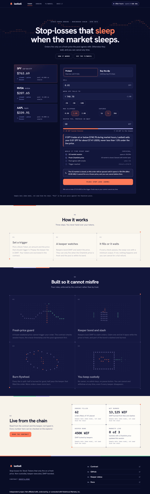
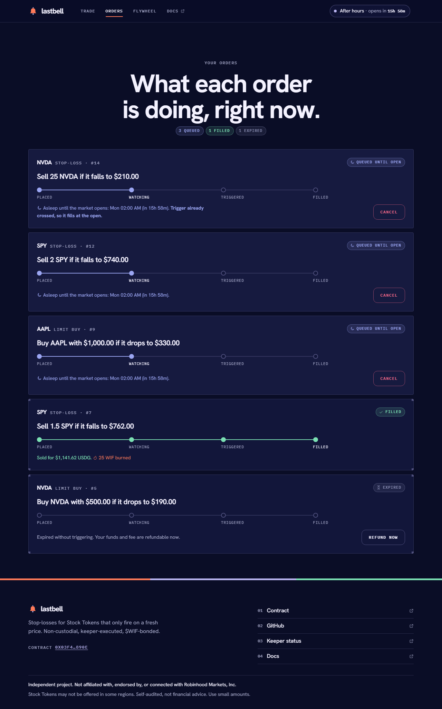
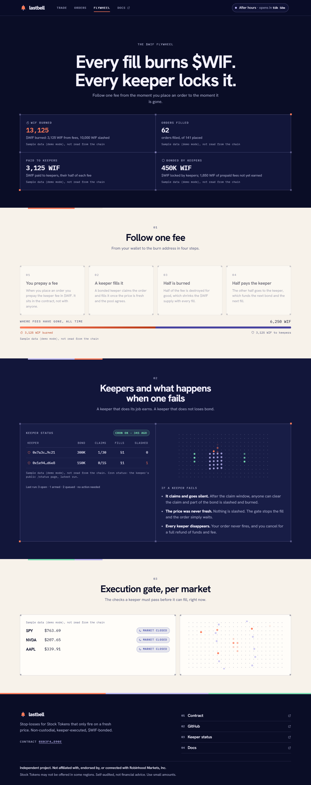

# Lastbell

**Stop and limit orders for Stock Tokens that only fire when the price is real.**

Built for the World is Flat Hackathon on Robinhood Chain. Live at **https://lastbell-cyk.pages.dev**. Orders are non-custodial, a bonded keeper executes them, fees are prepaid in $WIF, and half of every fee is burned.

## The problem

Stock Tokens trade on Robinhood Chain around the clock. Their Chainlink price feeds do not. They update during the 24/5 US session and then go quiet: a feed is about two days old by Sunday night, and it also freezes through holidays and corporate actions. The tokens keep trading in the pool the whole time.

A stop-loss that trusts a frozen price is dangerous both ways. It can fire on a weekend price that no longer means anything, or it can be gamed against the gap between the stale feed and the live pool. The evidence is in [docs/FEASIBILITY.md](docs/FEASIBILITY.md): every equity feed was about two days old on a Sunday night while the tokens kept trading.

Lastbell orders fire **only while the feed is fresh and the pool agrees with it**. The rest of the time they show as **queued until the market opens**, and you can cancel at any moment.

## How it works

1. **You place an order.** A stop-loss (sell if it falls to a price) or a limit buy (buy if it drops to a price) on SPY, NVDA or AAPL. Your tokens go into escrow in the contract, with exact approvals, and you prepay the keeper fee in $WIF.
2. **A keeper watches.** A Cloudflare Worker runs every minute. When the price has reached your trigger **and** the gate is fresh, it claims the order and fills it.
3. **The contract decides, not the keeper.** At claim and again at fill the contract checks the gate itself: inside the 24/5 session, updated since the session opened, within its heartbeat, issuer flags clear, and the pool within 1.5% of the feed. The swap goes through one fixed Uniswap v3 pool with a minimum output the contract derives from the oracle, and straight to you.
4. **If anything fails, nothing happens.** A closed gate, a stale price or a pool that cannot meet the minimum all mean the order waits. You can cancel and get everything back, including the unused fee.

The contract has no owner, admin, pause or upgrade. Details: [docs/CONTRACTS.md](docs/CONTRACTS.md).

## Why $WIF is load-bearing

$WIF is not decoration. Remove it and the product stops working:

- **Users pay in it.** Every order prepays a keeper fee in $WIF. The contract takes it from a prepaid balance or from your wallet when you place the order.
- **Keepers lock it.** A keeper must bond $WIF to be allowed to claim an order. The bond backs its claims: it can hold only `bond / slash` claims at once.
- **A failing keeper loses it.** If a keeper claims an order it could have filled and lets the claim lapse, part of its bond is slashed and **burned**.
- **Fills burn it.** On every fill, half of the fee is burned with `WIF.burn` and half is paid to the keeper.

## The flywheel

```
user prepays a $WIF fee ──► keeper bonds $WIF to claim ──► fill
        ▲                                                     │
        │                                      ┌──────────────┴──────────────┐
        │                                  50% burned                  50% to the keeper
        │                              (supply shrinks)             (pays for the next fill)
        └────────── more orders, more burn ◄──────────────────────────────┘
          a keeper that fails is slashed, and the slash is burned too
```

More orders mean more fees, more burn and more keeper income, which pulls in more bonded keepers. The Flywheel screen shows the real numbers from the chain.

## Architecture

| Package | What | Runs on |
|---|---|---|
| [`contracts/`](contracts) | Solidity (Hardhat 3, viem): escrow, gate, keeper registry, fee split | Robinhood Chain |
| [`keeper/`](keeper) | Order executor and public `/status` | Cloudflare Worker, 1-minute cron |
| [`web/`](web) | React app (Trade, Orders, Flywheel) and the region-notice Function | Cloudflare Pages |
| [`shared/`](shared) | Robinhood Chain config, verified addresses, market hours, the freshness gate | used by keeper and web |

Docs: [CONTRACTS](docs/CONTRACTS.md), [KEEPER](docs/KEEPER.md), [DEPLOY](docs/DEPLOY.md), [DEMO-PATH](docs/DEMO-PATH.md), [UI audit](docs/UI-AUDIT.md), [feasibility](docs/FEASIBILITY.md).

## Live links

| What | Link |
|---|---|
| App | https://lastbell-cyk.pages.dev |
| Keeper status (public JSON) | https://lastbell-keeper.plumbline-app.workers.dev/status |
| Contract (Robinhood Chain, verified) | [`0x03f4Bf9214474f38D6DD6d60591419a923B4890e`](https://robinhoodchain.blockscout.com/address/0x03f4Bf9214474f38D6DD6d60591419a923B4890e?tab=contract) |
| Security | [SECURITY.md](SECURITY.md) |
| Contract audit | [docs/AUDIT.md](docs/AUDIT.md) |
| Keeper and web audit | [docs/AUDIT-KEEPER-WEB.md](docs/AUDIT-KEEPER-WEB.md) |

## Try it as a judge

About 10 minutes and roughly **0.0003 ETH** (under a dollar), on real Robinhood Chain. Nothing here needs our help, and you can cancel your order at any time.

1. **Wallet.** Use a browser wallet such as MetaMask or Rabby. Open https://lastbell-cyk.pages.dev, click **Connect wallet**, and if it says your wallet is on another network, click **Switch to Robinhood Chain** (chain ID 4663, RPC `https://rpc.mainnet.chain.robinhood.com`; the wallet will offer to add it).
2. **ETH for gas and swaps.** Bridge about 0.0003 ETH to Robinhood Chain with [Relay](https://relay.link/bridge/robinhood), [Across](https://across.to/?to=robinhood) or the [Arbitrum bridge](https://portal.arbitrum.io/bridge?destinationChain=robinhood-chain&sourceChain=ethereum). Fees on the source chain can exceed an amount this small, so pick the cheapest route.
3. **A tiny amount of NVDA.** On [Uniswap](https://app.uniswap.org) (network: Robinhood Chain), swap about **0.0001 ETH for NVDA**. That buys roughly 0.001 NVDA (about $0.20), which is plenty. Check the token address on the swap screen: the NVDA Stock Token is the one in [`shared/src/markets.ts`](shared/src/markets.ts).
4. **A little $WIF.** On Uniswap swap about **0.00003 ETH for WIF** (about 40 WIF, enough for one order at the 20 WIF minimum fee). Paste `0x5173b8ea6923c2d40267890d45c46a3480954773` into the token search and check it reads **WIF**. Most other WIF pools are nearly empty, so if the quote is far below about 1,500 WIF per 0.001 ETH, stop and pick a different pool.
5. **Place a small stop-loss.** On the Trade screen click **NVDA**, set the amount to **0.001**, and the trigger a little **above** the live price (for example +1%) so it is already triggered. Check that **Would it fire right now?** shows four ticks, then click **Place stop-loss** and confirm in your wallet. You will see up to three prompts: approve NVDA, approve $WIF (both for the exact amount), then place.
6. **Watch the keeper fill it.** Open **Orders**. The card moves from **Watching** to **Triggered** to **Filled**, usually within a couple of minutes, and a **Fill tx** link opens the transaction. The Flywheel screen shows the burn. The keeper's public log is at **https://lastbell-keeper.plumbline-app.workers.dev/status** (open orders by state, the keeper's bond and its latest run).

If the market is closed (the chip at the top says so), the order is accepted and shows **queued until the market opens**. That is the point of the product: it does not fire on a frozen price, and it fills after the next open. Order 1 on mainnet is exactly that case. If your region is restricted the site turns order creation off but still lets you look around.

## Transactions on Robinhood Chain

Every mainnet transaction, with notes, is in [docs/TRANSACTIONS.md](docs/TRANSACTIONS.md). The hashes:

| What | Transaction |
|---|---|
| Deploy v1 (superseded after the audit, never used) | [`0x4833754690a20f62c3146cb996342f2b6ce1caf31c1beeca1d891a44533ef4a9`](https://robinhoodchain.blockscout.com/tx/0x4833754690a20f62c3146cb996342f2b6ce1caf31c1beeca1d891a44533ef4a9) |
| Deploy v2 (audited, in use) | [`0xbe79d9580ba05c6a94d2af5d5646f4d09044048e87d7cfd0650d73746a9dd958`](https://robinhoodchain.blockscout.com/tx/0xbe79d9580ba05c6a94d2af5d5646f4d09044048e87d7cfd0650d73746a9dd958) |
| Keeper approves 1,000 WIF | [`0x6d71358a5e68d0874e8f72f9a522c1df90f1b49e6c0fa7846b53068596f7a5b7`](https://robinhoodchain.blockscout.com/tx/0x6d71358a5e68d0874e8f72f9a522c1df90f1b49e6c0fa7846b53068596f7a5b7) |
| Keeper bonds 1,000 WIF | [`0x9679c589396d80931c8333df5aef64c75424068d5d006bda1c4fdf2a31e0b6ab`](https://robinhoodchain.blockscout.com/tx/0x9679c589396d80931c8333df5aef64c75424068d5d006bda1c4fdf2a31e0b6ab) |
| Order 0: approve NVDA | [`0xae72ea2f534c716dc86494fa81e8d1f590806cf3acecc05b32f5512137c04a2b`](https://robinhoodchain.blockscout.com/tx/0xae72ea2f534c716dc86494fa81e8d1f590806cf3acecc05b32f5512137c04a2b) |
| Order 0: approve WIF | [`0x0d2cbbbf9ac0e922f800680dd856ac55e576566536c6df8407231e050a8cf61d`](https://robinhoodchain.blockscout.com/tx/0x0d2cbbbf9ac0e922f800680dd856ac55e576566536c6df8407231e050a8cf61d) |
| Order 0: place (0.0001 NVDA stop-loss) | [`0xa22fa59366dda3bbe07381b92a15f91819841a97394a0c1ae300e45b401f65e2`](https://robinhoodchain.blockscout.com/tx/0xa22fa59366dda3bbe07381b92a15f91819841a97394a0c1ae300e45b401f65e2) |
| Order 0: keeper claims | [`0x2952bf0257c6277ac6743f1494111dca7470ade939ae78629d0ade467f0f78bb`](https://robinhoodchain.blockscout.com/tx/0x2952bf0257c6277ac6743f1494111dca7470ade939ae78629d0ade467f0f78bb) |
| Order 0: keeper fills (10 WIF burned, 10 WIF to the keeper) | [`0x8c0e99caed66ccc09104064f5702e021c05740dd2eb9b9fcdb67c878154e1a90`](https://robinhoodchain.blockscout.com/tx/0x8c0e99caed66ccc09104064f5702e021c05740dd2eb9b9fcdb67c878154e1a90) |
| Order 1: approve NVDA | [`0xaee45f407aa6eb346ee08f3eb00771a62fd0905f86fcd11e87d4ce1d366e517c`](https://robinhoodchain.blockscout.com/tx/0xaee45f407aa6eb346ee08f3eb00771a62fd0905f86fcd11e87d4ce1d366e517c) |
| Order 1: approve WIF | [`0xcd88904c4ac78fb5a8288b619e0025398374bd639289823992bcac08619cb7ee`](https://robinhoodchain.blockscout.com/tx/0xcd88904c4ac78fb5a8288b619e0025398374bd639289823992bcac08619cb7ee) |
| Order 1: place (0.0001 NVDA stop-loss at $182.59, placed on a Sunday, queued until the market opens) | [`0x1ea41b895ec6494f285fab3a436c74e3a5404e749ad1bf49a11e0eaa39391ad0`](https://robinhoodchain.blockscout.com/tx/0x1ea41b895ec6494f285fab3a436c74e3a5404e749ad1bf49a11e0eaa39391ad0) |

Funding transfers into the two wallets are not listed. Order 1 is a weekend order: it was placed on a Sunday with the market closed, and it waits as **queued until market open**, which is the point of the product. A limit buy and a cancel have not been run on mainnet yet. They are covered by the contract tests, and place, fill and cancel were also run on a local chain.

## Screenshots

| Trade | Orders | Flywheel |
| --- | --- | --- |
|  |  |  |

The same screens work on a phone:


## Develop

Requires Node 22+.

```bash
npm install
```

```bash
npm test
```

```bash
npm run dev -w web
```

Without a contract address the web app runs on demo data. Add `?demo&at=2026-11-07T15:00:00Z` to the URL to see a chosen moment, for example the weekend "queued until open" state.

Web build settings: `VITE_LASTBELL_ADDRESS` (contract), `VITE_KEEPER_URL` (keeper Worker, for `/status`) and `VITE_DEPLOY_BLOCK` (first block to search for fills).

### Local test chain (real transactions, no real funds)

Run each command in its own terminal from `contracts/`:

```bash
npx hardhat node --network hardhatLocal
```

The `hardhatLocal` network starts at the real current time. Tests use the default network, which starts at a fixed date (1 Nov 2026) so they never depend on the real clock.

```bash
npx hardhat run --network localhost scripts/local/deploy.ts
```

The deploy writes `web/.env.local` (gitignored). The app then runs against the local node and shows a "Connect wallet" button for Hardhat's test account. To move a price and run the real keeper engine once:

```bash
SYMBOL=SPY PRICE=735 npx hardhat run --network localhost scripts/local/price.ts
```

```bash
npx hardhat run --network localhost scripts/local/keeper.ts
```

Delete `web/.env.local` afterwards to go back to demo mode.

Read-only research scripts (they hit the public RPC):

```bash
npm run spike:feeds -w keeper
```

## Security

Read [SECURITY.md](SECURITY.md): the threat model, what is and is not protected, the audit findings and fixes, and the honest limits. In short: the contract has no owner or admin, this was a self-review with no third-party audit, and $WIF liquidity is thin.

## License

MIT
